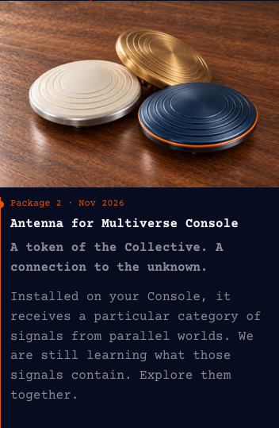
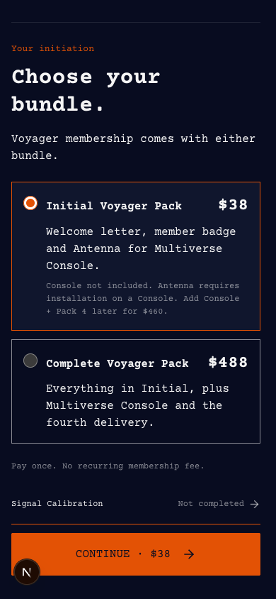
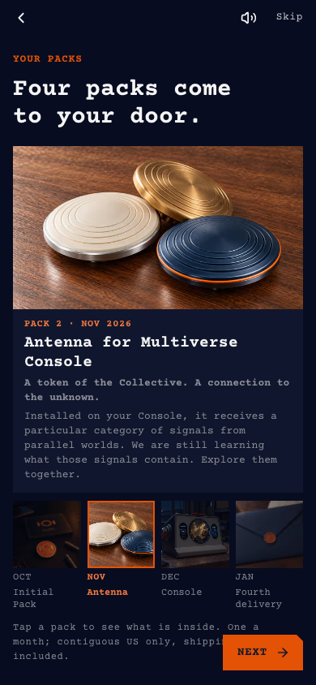
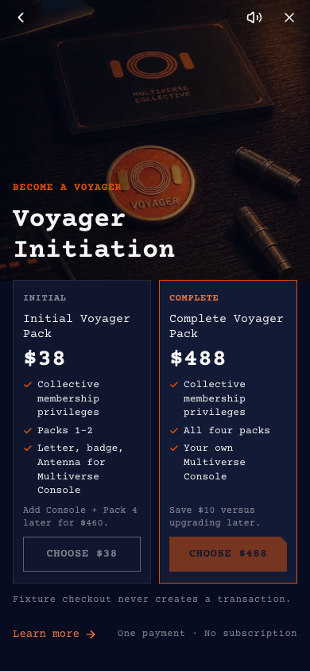

# Antenna 文案与配图验收

日期：2026-10-22。参考方向：本次对话用户确认的嵌入式扁伞帽三款造型，以及把它们取下摆放于桌面的要求。设计依据 `docs/design-system.md`。实际实现于独立 `codex/antenna-collective-emblem` 分支，未发布生产。

## 业务范围

Voyager 购买页 → Pack 2、套餐选择与 FAQ → briefing Pack 2 和报价页 → 交付说明、后续邮件模板。统一 Antenna 名称，首次写全名；先表达组织信物／装饰收藏价值，再表达特定品类信号和共同探索；清楚说明必须安装于 Console 及 Initial 不含主机。

价格及权益逻辑未修改；无迁移、数据库修改、Stripe 操作或邮件发送。历史交易、旧条款与发布档案保留。外部数据源未验收，数据库驱动的历史批次标签仍按原记录展示。

## 浏览器检查

本地开发 fixture：`/dev/voyager-initiation?state=unpaid&qa=1`；briefing 使用已有 `briefing=1` 直达参数。使用无效占位 Supabase 配置，不加载生产环境文件；浏览器拦截所有非本地请求，没有提交支付。

- 首先检查 390×844，再检查 1440×1000；字体 Courier Prime，正文 16px，补充说明沿用 12px 下限，未新增品牌颜色或装饰效果。
- 手机主页面的 Antenna 行使用单列大图＋正文，≥768px 继续沿用既有双列。桌面仍为左图右文。
- briefing 新图使用 16:9 框，保留三件物体完整轮廓；精简说明后，四个包裹缩略图及其名称在 390×844 下均位于 NEXT 上方。更长内容仍可在现有页面内滚动。
- 主购买卡 $38、Complete $488 与升级 $460 提示保留。用户随后确认精简：购买页及 briefing 的 Pack 2 仅保留加粗的 “A token of the Collective. A connection to the unknown.” 与指定接收／共同探索正文，不追加适用性和设计示意段落。briefing 套餐页仅保留后续升级价格；安装／主机边界继续保留在主购买卡、FAQ 与交付说明。
- 新图片加载成功，替代方块／圆筒／矿石旧图；没有整页或 briefing 横向溢出。最终浏览器运行没有 pageerror。旧演示图未删除或改标。
- 只验证展示内容、包裹切换和 briefing 导航；付款、发货和实际天线接收能力不在本次验收范围。

## 截图

