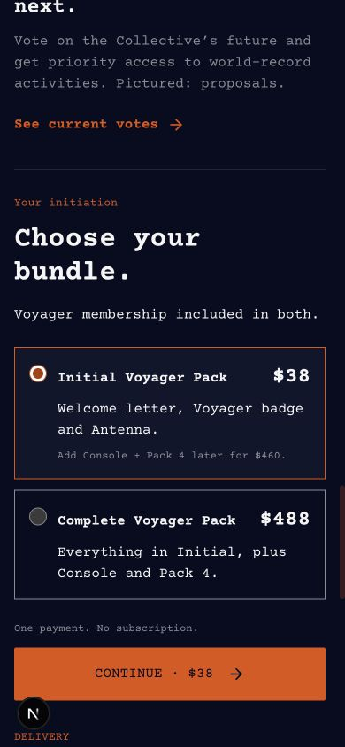
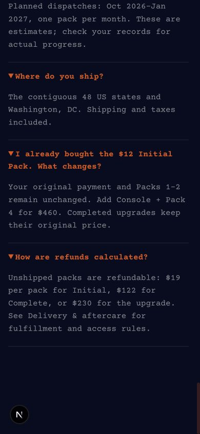
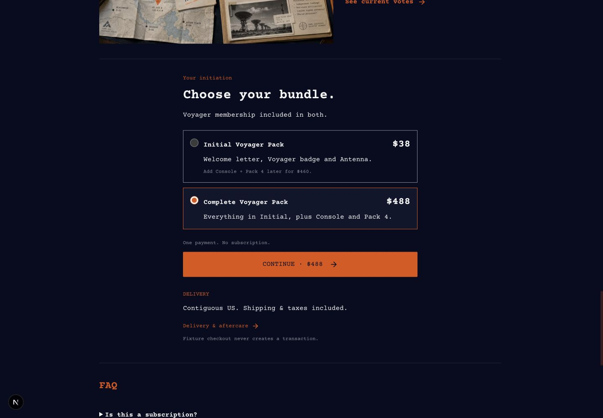

# Voyager Initiation 文案精简验收

2026-10-23。依据用户在上一轮逐段审阅后确认的建议；保留 `docs/design-system.md` 的字体、字号、颜色、间距、媒体与按钮位置。

## 实现范围

- Pack 1、Pack 4 各缩为一句；主页面、briefing 包裹页与 bundle preview 同步。
- Mission Board 删除重复介绍；Classified Intel 缩短正文；投票权益保留优先参与及图片为提案的边界，现有投票入口改为 “See current votes”。
- 套餐共通权益、内容描述、一次付款与配送提示缩短。价格仍为 Initial $38、Complete $488、升级 $460。
- 保留 11 个 FAQ 问题及折叠结构，精简其中 10 个答案。退款摘要保留未发货可退及每包 $19／$122／$230 的分摊，加入指向现有 `/terms/initiation` 的实际链接。
- Antenna 的包裹介绍、共用详细文案和 Antenna FAQ 保持原文；Console 产品介绍保持原文。使用与基准提交 `2d4980e9f439c8338ac99d4e58c6742298c20f53` 的逐字比较确认。
- 完整交付条款已有授权付款、计划月份、批次领取、更换、历史订单与退款权益细则，文件逐字未变。无价格、权益、付款逻辑、数据库、迁移或历史记录修改。

## 浏览器验证

在无效占位服务配置下运行本地 `/dev/voyager-initiation?state=unpaid&qa=1`，未提交结算。

1. 首先以 390×844 检查套餐和全部展开的 FAQ；正文自然换行，无截断或缩小字号。保持 Courier Prime、既有橙色／深蓝／灰白以及既有图片和操作位置。
2. 点击退款答案中的 Delivery & aftercare，确认到达完整条款，包含履约定义、退款分摊、原始订单独立性和权益处理。
3. 再以 1440×1000 验证 Complete 选中后 CTA 为 $488，Initial 保留 $38 与 $460 升级提示。
4. briefing 第八页切换 Pack 1、Pack 4，确认显示新的短简介；Antenna 和 Console 的对应条目逐字不变。

类型、lint、单元测试和生产构建按仓库要求执行；检查结果见 PR。此轮仅验证文案、展示、套餐切换与条款链接，未验证真实付款和发货。

