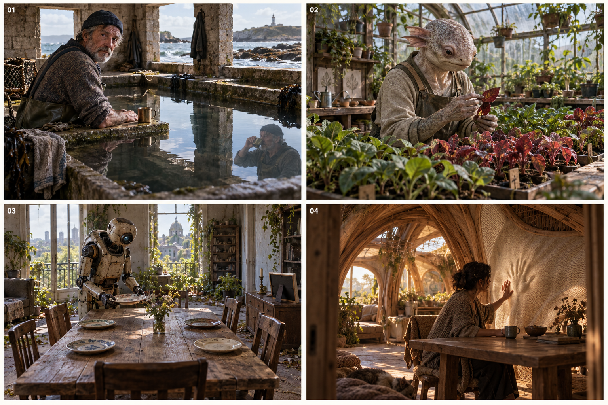
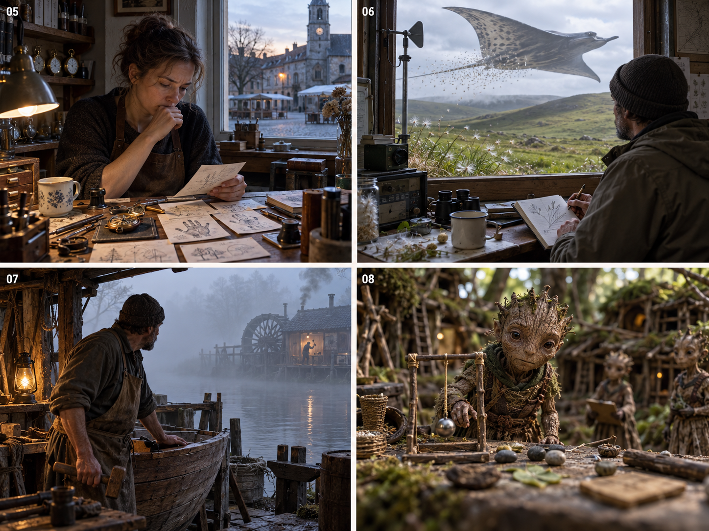

# 平行世界互动方向探索

后续整理：[平行世界互动规则与标志事件](../world-interaction-rules.zh.md)，包含三种玩家策略、世界反馈结构、历史记录标准及牧羊女、机器人、精灵的讨论示例。

本轮为概念探索，尚未选定世界或制定底层规范。八个方向均为新设想，不表示设备已实现这些世界反应。共同出发点是：世界里的智慧生命或运行规律带来某种困惑；跨世界的观察者拥有不同视角，可以共同观察、尝试影响，再通过语言协助对方理解和行动。对方有自己的解释、意愿和生活，不必接受观察者的判断。

设备基础沿用[操作说明](../../device-reference/console-operations.zh.md)。早期通过长按蓄能造成轻微影响，之后在适合的世界开放语言随能量发送。下列 Bands 是可用视角设想，不是任务关卡。图片展示世界内部固定观察视角，不包含设备外壳。

## 01 慢半拍的海

**困惑：**海边居民把潮池当成镜子，却发现倒影偶尔做出自己没有做的动作。守潮人担心自己的记忆出了问题。

**观察者的独特位置：**我们能够同时看到人和水中的倒影，并跨次记录，逐渐发现倒影与现实之间存在变化的时间差。倒影也可能通向另一个时间，而非单纯延迟；这是待探索的谜，不提前公布标准答案。

**接触发展：**能量先在无风时引起水面波纹，守潮人注意到波纹与异常的联系。语音接触后，大家可以描述他尚未注意的差异，请他自行验证，而不是直接替他解释全部真相。

**持续事件：**他开始用倒影作决定，又遇到一次倒影与现实不符。社区共同面对的是如何理解、何时信任这种现象。

**Bands：**室内潮池、堤岸上的人、涨潮后的空屋。

## 02 看不见颜色的园丁

**困惑：**一个有智慧的物种只能辨认形状和纹理。园丁发现外形相同的植物有时能食用，有时使同伴生病，却不知道颜色暴露了它们的状态。

**观察者的独特位置：**我们看得到他们感知不到的色彩；他们则可能感受到我们看不到的气味或振动。双方各自缺少一部分信息。

**接触发展：**能量让一株植物的叶片轻微运动，园丁开始注意被指向的对象。语言阶段可以协助他为不同状态建立自己的标签，让他能用触觉标记、栽种习惯等方法独立区分。

**持续事件：**从解释一次误判，发展为共同认识这片生态。观察者也会犯错，需要听取园丁的经验。

**Bands：**育苗台、分拣桌、野生植物边缘。

## 03 等不到客人的机器

**困惑：**人类离开后，一台家务机器仍然每天摆好六副餐具。它知道主人迟到了，却不知道“不会回来”意味着什么。

**观察者的独特位置：**我们可以理解屋里的生活痕迹，帮助它逐渐辨认离开、失去与选择；我们同样不能确定主人的最终下落。

**接触发展：**能量让空座旁的旧灯亮起，它以为有人回家，开始在那里等待。语言接触后，它先询问主人的消息，再可能询问自己为什么还要继续准备晚餐。

**持续事件：**它是否离开房间、接待新的生命，或为自己安排一天。共同进程是它对自身生活的理解改变，而不是修复部件清单。

**Bands：**餐桌、门厅、窗外逐渐恢复生机的街道。

## 04 不会说话的房子

**困惑：**房屋本身是一种缓慢的智慧生命。它通过墙壁形变、温度和门窗变化表达需要，住户一直把这些理解成故障，房子则把维修理解成拒绝。

**观察者的独特位置：**跨 Bands 看见房子的变化与住户行为之间的对应，可以提出“它在沟通”的另一种解释。

**接触发展：**能量造成一次轻微收缩，房子开始向观察位置重复这个动作。之后语音可以帮助住户尝试理解，也可能以振动被房子感知。

**持续事件：**两个共同生活却互不理解的生命慢慢建立相处方式。观察者充当翻译的尝试者，不拥有一套现成词典。

**Bands：**公共房间、门廊、墙体内部的缓慢变化。

## 05 每天忘记昨天的小镇

**困惑：**小镇居民每次睡醒都会失去前一天的记忆，只能依靠物件、习惯与留下的字条生活。某位钟表匠开始怀疑，镇上公认的历史并不可靠。

**观察者的独特位置：**我们保留跨日观察，能够帮助居民找回连续性，但不应成为唯一无法质疑的记忆来源。

**接触发展：**能量使某个旧铃在每天相似时刻响起，钟表匠留下关于它的记录。语音阶段可以提醒他检查自己前一天留下的证据，而非要求他相信陌生声音。

**持续事件：**居民决定哪些经历值得保留、如何互相验证，以及要不要恢复那些曾主动选择遗忘的事情。

**Bands：**钟表铺、广场留言处、第二天同一张早餐桌。

## 06 被当成灾害的天空迁徙

**困惑：**高地居民每隔一段时间便遭遇遮天蔽日的巨大生物，认为它们来摧毁家园。年轻记录员发现植物总是在它们经过后重新生长。

**观察者的独特位置：**不同 Bands 展示迁徙前后和不同地点的变化，让社区有机会发现灾害与生态循环之间的关系，而非仅看见一次恐怖的经过。

**接触发展：**能量引起观测塔上细小物件的变化，使记录员注意外部存在。语言接触后，可以协助她比较证据、选择新的观测位置，而不保证迁徙毫无危险。

**持续事件：**从恐惧和驱逐，发展到是否愿意调整定居方式，与一种无法控制的生命共存。

**Bands：**观测塔、荒地、经过迁徙后出现新芽的山谷。

## 07 只听见对方声音的两岸

**困惑：**两个群体隔着常年浓雾生活，只听到对岸敲击和机械声。双方都把对方维持生活的声音误认成威胁。

**观察者的独特位置：**我们可以切换到两岸的 Bands，看见每种声音实际来自什么；当地人无法获得这种同时理解双方的视角。

**接触发展：**两岸分别注意到能量造成的小变化，逐渐把观察者当成能够回应的存在。语言阶段尝试传达事实，鼓励他们自己验证、建立直接联系。

**持续事件：**误解、信任和不同诉求逐渐显露。我们能协助沟通，但不能通过一句话让长期冲突消失，也不替双方作决定。

**Bands：**一岸的水轮工坊、另一岸的修船台、浓雾中的渡口。

## 08 把我们当成天气的人

**困惑：**一个微小文明发现，某处偶尔会出现无法解释的光与震动。有人称之为神迹，有人认为是天气，一位研究者怀疑它有意图。

**观察者的独特位置：**我们知道部分现象来自自己的能量输入；但观察者也需要面对自己给对方社会造成的解释和影响。

**接触发展：**研究者开始留下可重复观察的实验，尝试确认另一端。语言阶段需要逐渐建立共同符号，不能默认他们马上理解人类语言。

**持续事件：**他们如何认识我们的存在，是否欢迎联系，以及我们如何回应他们的提问。最终可能是对方也开始系统地研究我们。

**Bands：**微小文明的观测台、公共讨论场、放在观察位置前的实验物件。

## 讨论时优先比较什么

先比较哪些困惑令人愿意持续观察，哪些生命让人愿意帮助，以及双方关系能否自然延续。暂不制定统一阶段、数值门槛、完成条件或世界生产规范。

全体玩家参与的是同一个世界的变化。一次语音不必对应一个即时回应，居民可以在自己的时间里消化、误解、验证和行动。具体汇总与回应机制留待方向选定后讨论。

## 概念图

概念图编号与以上方向一一对应。图片用于故事与视角探索，不是最终量产素材或已实现玩法截图。

### 第一组 时间与生命的困惑

### 第二组 社区与文明的困惑

[完整提示词与图像复查记录](generation-notes.md)

