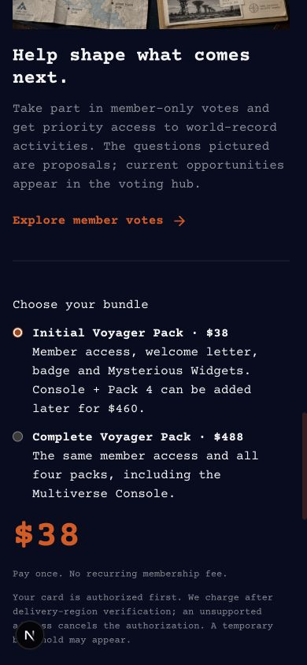
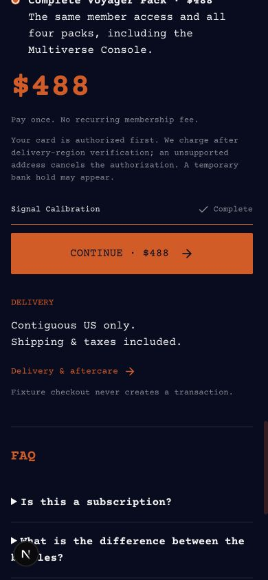
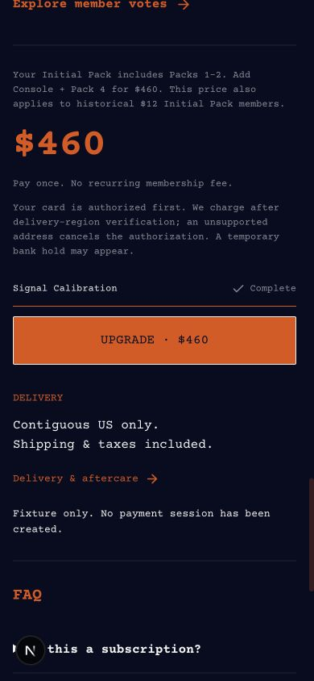
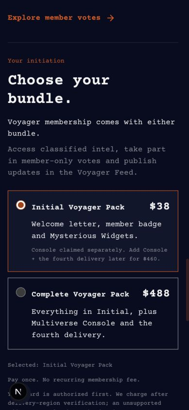
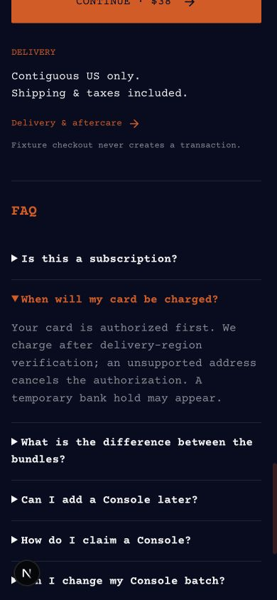

# Voyager 新定价整合

2026-10-21 用户确认新价格：Initial Voyager Pack **$38**，Complete Voyager Pack **$488**，Initial 成员新增 Console + Pack 4 **$460**。历史 $12 Initial 买家也按 $460 进行新的升级购买。已完成的旧 $520/$400 订单不改实付金额、不追收差价。

状态：**代码与迁移已整合并提交 PR 供审阅，尚未合并或应用生产迁移；没有修改线上 Stripe、创建订单、付款或发送邮件。**

## 已整合的行为

- `src/lib/initiation-pricing.ts` 为当前价格、商品名称、Price 环境变量与报价版本的统一来源。
- 正式 Initiation 页面沿用此前套餐预览的卡片选择形式：整卡可点击、橙色选中边框、价格在右侧，并展示两档共享的会员权益；金额、读屏标签、按钮与实际提交的商品选择同步。登录回跳保留所选商品。
- 新旧两代 Initial 成员在服务端核验资格后统一获得 $460 升级报价，不能通过浏览器传入金额或 kind 获取其他价格。
- 正式 FAQ、配送退款条款、旧 Pack 入口、设备引导、Newsletter CTA、确认邮件纯模板及开发演示同步新价格。中英文现行商业规格单独列出新政策，旧规格移入同目录明确标注的历史档案。
- 新 Initial 仅生成前两包、会员与一个席位，不生成 Console entitlement。升级保留原前两包，只新增 Console 与 Pack 4，复用原席位；满额时已占席的 Initial 成员仍可升级。
- 退款按本次购买包含的包数均分：Initial $19/包、Complete $122/包、升级 $230/包。原 Initial 与升级支付独立。升级退款保留有效 Initial 会员；Initial 付款被撤销时，依赖它的升级设备权益暂停复核。
- 新订单写入 `pricing_version=voyager-bundles-v1`。旧版本的 $520/$400 订单、Price ID、回调和在途支付仍按原金额验证。订单报价字段不可在之后改写。
- PostHog 和 Meta 发送订单真实实付金额，避免把新标价覆盖到历史收入。促销码仍关闭，标价继续含美国本土运费和适用税费。

当前 $38 + $460 = **$498**，直接 Complete $488 节省 **$10**。升级是固定追加付款，不是 $488 减去此前付款额。

## 数据库迁移

新增 `supabase/schema_v103.sql`，未编辑任何已存在的版本化迁移，**尚未应用生产**。迁移增加价格版本和新 Initial 付款来源，扩展新报价约束、预订和完成付款函数、会员权限、退款依赖与前两包履约。旧 `reserve_initiation` 停止产生旧价新订单，新应用改用 `reserve_initiation_v2`；历史付款完成函数保留兼容入口。

`eligible_legacy_initiation_order` 继续核验历史 $12 的真实付款资格；`eligible_initial_initiation_order` 核验新 $38 Initial 订单。两者共享当前 $460 的 `legacy_upgrade` kind，通过来源字段区分。该 kind 名称保留接口兼容，不代表新买家只能享受旧优惠。

## Stripe 与环境要求

三个 Price 必须独立、active、one_time、USD、inclusive，并属于专用 Initiation 产品。应用每次创建 Checkout 前读回并验证金额、产品和 live/test 模式；不能只替换页面或复用旧 Price ID。

| 配置 | 对应值 |
| --- | --- |
| `INITIATION_PRICING_VERSION` | `voyager-bundles-v1` |
| `STRIPE_INITIATION_PRODUCT_ID` | 专用产品 ID，需正式环境确认 |
| `STRIPE_INITIATION_INITIAL_PRICE_ID` | 3800 cents 的新 Price |
| `STRIPE_INITIATION_PRICE_ID` | 48800 cents 的新 Complete Price |
| `STRIPE_INITIATION_UPGRADE_PRICE_ID` | 46000 cents 的新升级 Price，包括旧 $12 用户 |
| `INITIATION_CHECKOUT_ENABLED` | 切换准备和验收期间保持 `false` |
| `INITIATION_TERMS_APPROVED`、`INITIATION_FULFILLMENT_POLICY_APPROVED` | 完成新条款/履约确认后按实际状态设置 |
| `INITIATION_SHIPPING_COUNTRIES` | `US` |
| `INITIATION_SHIPPING_POLICY`、`INITIATION_TAX_POLICY` | `included` |
| `INITIATION_TERMS_URL` | 正式站 `/terms/initiation` 的 HTTPS 绝对地址 |

缺少当前版本或任意一档独立 Price 配置时，新结算保持关闭。旧 Stripe Price 对象不要修改或删除，历史回调继续使用订单已保存的事实。`scripts/verification/configure-initiation-stripe.mjs --test` 只用于明确隔离的测试账户，会创建测试 Price 并更新本地 env；本次没有运行。只读环境审计脚本已经改为核对三档价格。

正式 Vercel env 访问此前返回 403，正式 Stripe 当前对象及新 Price ID 尚未读回。仓库里的旧 Price ID 发布记录属于历史映射，不能用作新报价配置。

## 本次验证

- `npx tsc --noEmit` 通过。
- `npm test`：89 个文件、730 项测试通过；包含新价格版本验证、历史金额兼容、Initial 会员状态与登录回跳选择。
- `npm run design:check` 通过。
- `npm run lint`：0 errors，26 warnings；现有警告未扩大修改范围。根项目检查排除 `output/` 及独立 Sites 的编译输出，保留这些生成文件，没有清理用户文件。
- `node scripts/verification/initiation-offline.mjs`：79 项实际 API / webhook / SDK 离线断言通过。网络、数据库、邮件与 Stripe 均为显式内存适配器；包含 $38/$488/$460、旧 $12 和新 Initial 资格、拒绝伪造报价、资格撤销后取消授权。
- `supabase/tests/initiation-bundles-v103.mjs` 在独立内存 PGlite 中通过：新三档、旧 $12 升级、旧 $520/$400 付款完成、无重复包裹/席位、满额升级、退款依赖、不可变报价与 RPC 权限。没有连接生产数据库。
- 本地实际 Next 页面在桌面 1280×720 及手机 **390×844** 核验。Initial / Complete 单选、价格和 CTA 同步，旧 $12 与新 $38 成员均显示 $460 升级；手机 document 宽度为 390，没有横向溢出。支付前检查使用 fixture，不创建 Session。
- 生产构建通过。构建初次遇到 Webpack 旧缓存错误；保留原 `.next` 到 `/private/tmp/putopia-pricing-next.*` 后重新构建成功。

截图保存在 `output/pricing-integration-20261021/`，均为本次保存后重新打开检查的截图，显示本地 fixture，**不是线上已改价证明**。首屏的 26 名成员为开发 fixture，不代表生产人数。

## 购买区交互更正

用户指出整合后的普通单选列表偏离之前的套餐预览。现已将购买区恢复为 `src/app/dev/voyager-bundles` 的卡片形式，去掉重复的大号金额，保留真实校准、登录和结算流程。旧 $12 用户仍仅展示 $460 升级卡片，资格由服务端判断，不提供预览稿中的模拟身份切换。

390×844 实际页面确认无横向溢出，Initial / Complete 切换同步选中状态、摘要和 CTA（$38 / $488），历史 $12 用户显示 $460 卡片及升级按钮。更正后 `design:check`、`tsc --noEmit`、页面 ESLint、价格与导航 10 项测试通过。上方 03–05 截图为更正前的整合记录；当前购买区如下：

购买区已去掉额外的会员权益长说明；预授权、配送地区核验与临时银行冻结说明移入 FAQ「When will my card be charged?」，购买区仅保留简短的一次性付款提示。

## 后续生产切换

以下是部署交接要求，本次未执行：

1. 关闭新 Checkout，保留 Webhook 和历史订单 reconciliation。将本次定价变更与用户其他未提交工作分开审阅。
2. 只读核对现有订单、在途会话和新 Stripe 三个 Price；保留旧 Price ID 和实付记录。应用 v103 新迁移并读回约束/RPC，不重新执行旧版本迁移或批量改价历史订单。
3. 部署与迁移匹配的应用，配置当前价格版本、三个新 ID、配送与条款参数，先保持收款关闭。验证旧客户端不能继续生成 $520/$400 新订单，原会话回调仍可完成。
4. 在授权的隔离 Stripe / Supabase 环境完成真实 Checkout、签名 Webhook、退款与配送全过程验收；现有较早的 `initiation-sandbox-*` / `initiation-full-*` 实验脚本保留原实验版本，不作为本次新价已通过真实 Stripe E2E 的证据。
5. 生产页面、登录身份、移动端和实际结算金额确认后，再由获授权的发布操作开放新 Checkout。不能以本地 fixture 或内存测试替代正式 Stripe 金额核验。

用户原有两处已跟踪文档修改及全部其他未跟踪文件保留；PR 仅收录本次定价与购买区调整，没有合并或修改生产数据。
