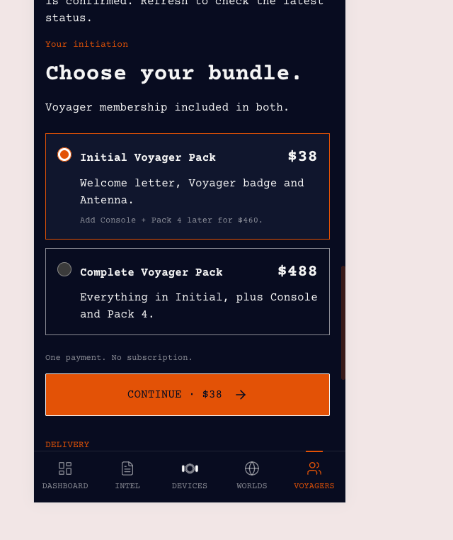
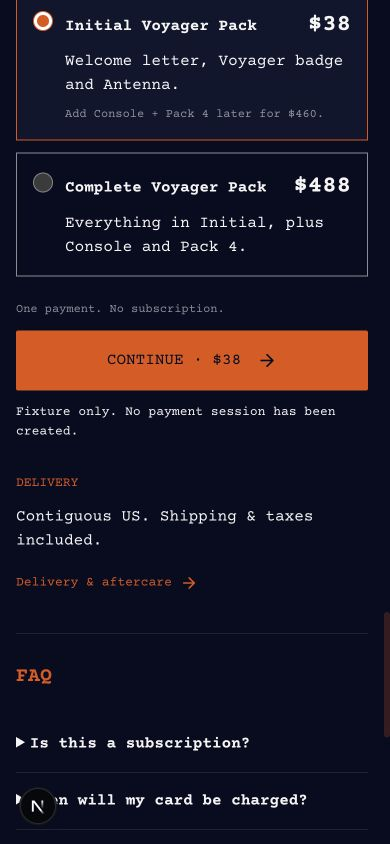
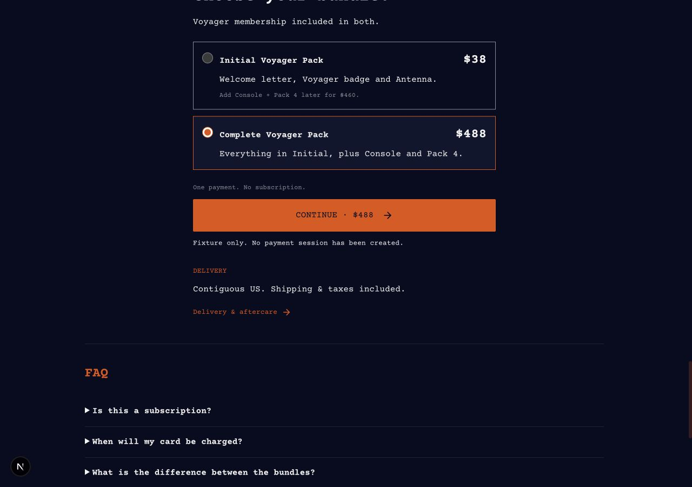
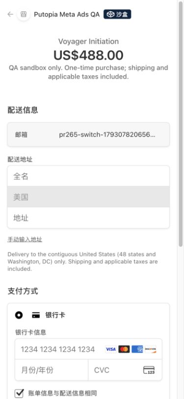
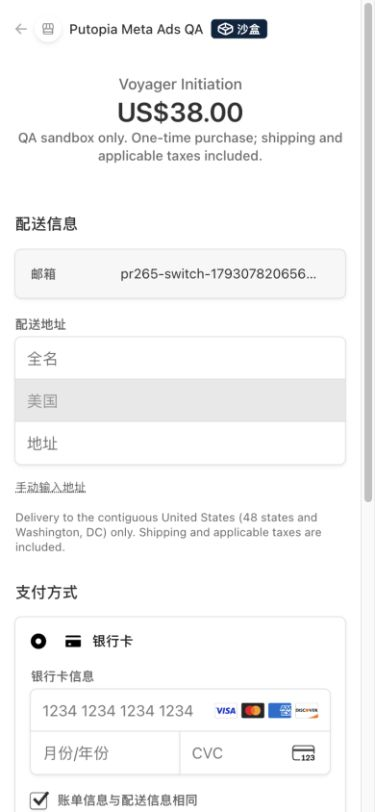
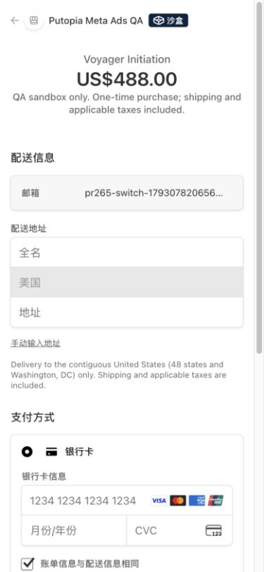

# Initiation 方案切换修复验收 · 2026-10-27

基于远端 `main` 的 `6852591f`。原工作区的未提交修改保留在原处。

## 问题与证据

- 用户报告选择 $38 后没有跳转，$488 可以继续。
- 只读检查线上购买页：已显示 `Checkout is unavailable. Check existing orders and seat availability on Initiation.`，但位置在 Delivery 下方，用户截图的可见区域没有包含它。
- 只读检查生产库：当时只有一笔活跃的 Initiation 订单，为 `standard / pending / 48800`，已有 Stripe Session、没有保存的 PaymentIntent。创建时间为 `2026-10-27 04:50:44 UTC`，预留到期时间为 `05:25:44 UTC`。没有读取或记录用户身份。
- `reserve_initiation_v2` 要求待支付订单的方案与本次选择相同，否则抛出 `Existing checkout requires reconciliation`。因此 $488 复用成功，$38 无法创建新订单。
- Vercel 对所查接口的运行时错误和最近日志没有提供额外信号；诊断依据是线上可见报错、订单状态和预留函数代码。

## 修复行为

- 两个结账入口共用 `createInitiationCheckout`，因此登录购买和邮箱直接购买都经过同一修复。
- 同一方案仍复用原来的订单与 Session。
- 切换方案前核对旧订单及 Stripe Session 的归属、金额、币种、运行模式与商品元数据。先使未付款的旧 Session 过期，确认无法继续付款，再条件更新旧订单为 canceled，最后走现有预留函数创建新方案。
- 若旧 Session 有 PaymentIntent，还须确认其已取消且没有收款。已付款、处理中、审核中、丢失 Session 绑定、超时或并发变化时，均保留旧记录并停止切换。
- 错误提示放在购买按钮后、Delivery 前；提示获得焦点并滚动到视口中部，避免被底栏遮住。
- Stripe 仅允许使 open 状态的 Session 过期；详见[官方 API](https://docs.stripe.com/api/checkout/sessions/expire)。

## 验证

- `npm run design:check`、`npx tsc --noEmit`、`npm run build`：通过。
- `npm run lint`：0 errors，26 个现有 warnings。
- `npm test`：98 个文件、852 条测试通过，其中新增 35 条切换与支付保护回归测试。所有测试均使用内存依赖，无数据库、网络或环境变量访问。
- 浏览器使用 `/dev/voyager-initiation?state=pending&qa=1` 与本地假配置，未加载生产服务密钥。
- 手机 390×844：选择 $38 并点击后，错误提示获得焦点，顶部约 402px、底部约 441px，完整可见。
- 桌面 1280×900：改选 $488，按钮价格同步更新；点击后错误提示获得焦点，顶部约 440px、底部约 460px。
- 沿用设计系统和既有 CSS：Courier Prime、品牌橙 / 深蓝 / 灰白文字、原字号和间距。按钮和方案卡结构、图片均保留，仅调整错误提示的位置及焦点行为。

修复前参考：用户提供的手机截图。

未创建、取消或支付任何生产订单，未修改生产配置；无需数据库迁移。

## 真实 Stripe 跳转验收 · 2026-10-27

按用户要求，在合并前完成隔离环境验收。QA 部署为 `dpl_DDLyfd2j3FLLUEYfTsQ3AQ6eSgLX`，部署源是 `35b61dbb1626686248f30bc5bd0f23812bdc2c9e` 的 tracked 文件快照；三个修改的业务源文件与 PR 逐字节相同。部署配置仅替换为既有 QA 凭据，关闭 crons、邮件发送、浏览器广告像素和 Meta 回传。没有修改正式项目的环境变量。

使用独立 Stripe 沙盒 `acct_1UTxRiAPEEV0NYJ8` 和独立 Supabase 分支 `gqcgdmmmmfbatdneacny`。手机视口为 390×844，同一虚构测试账号贯穿以下场景：

| 场景 | 入口与结果 |
| --- | --- |
| 首次 $488 | 实际页面按钮 → 邮箱弹窗 → `/api/initiation-checkout/email` → Stripe，显示 **US$488.00** |
| $488 → $38 | 返回页面改选 Initial，再提交同一邮箱 → Stripe，显示 **US$38.00**；旧 $488 Session 为 expired、旧订单 canceled |
| 同方案重试 | 测试账号激活后，以其真实认证 Cookie 调用 `/api/initiation-checkout`，选择 Initial；HTTP 200，返回同一个 $38 Session，无新订单 |
| 登录后 $38 → $488 | 实际页面按钮 → 邮箱与密码登录 → 认证结账接口 → Stripe，显示 **US$488.00**；旧 $38 Session 为 expired、旧订单 canceled |

三次浏览器导航均实际到达 `checkout.stripe.com`。Stripe API 确认三笔 Session 全部 `livemode=false / payment_status=unpaid`，无 PaymentIntent、无 paid_at；未填写银行卡或提交支付，也未接受付款条款。机器回执见 [stripe-verification.json](stripe-verification.json)。

验证完成后，三笔测试 Session 全部 expired，测试订单全部 canceled；记录保留。QA 批次恢复 `checkout_open=false / stripe_livemode=false`，QA Vercel 项目恢复暂停，Stripe webhook 始终 disabled。QA 数据库未暂停、未重置、未改变分支持久性。正式业务库及正式 Stripe 未参与测试。此验收覆盖真实托管页跳转与方案切换，不声称完成扣款或支付 webhook 验收。
