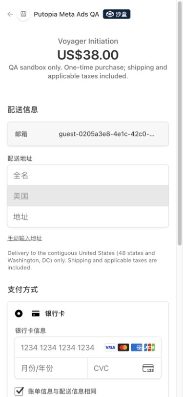
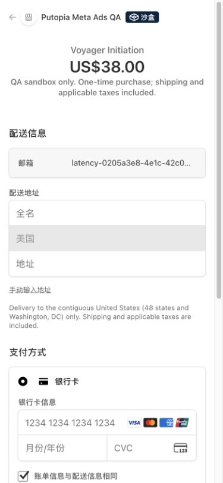

# Initiation 结账提速验收 · 2026-10-27

业务代码验收提交：`aa4a454df6a22bd0e49d073e8eab45f33d680c80`。PR #267。

## 改动

- 普通邮箱购买的激活邮件，以及新建 / 复用结账会话后的统计回传，使用 Next.js `after()` 在响应完成后执行。没有使用无法保证进程存活的浮动 Promise。
- 首次结账事件仍由绑定 Session 的 SQL trigger 持久入队，归因仍在创建 Stripe Session 前保存；统计失败由原 outbox / cron 重试。未新增定时任务。
- 必须先激活、已经是会员或待确认升级的分支，仍在回复“已发送”前确认邮件结果；普通购买的邮件失败继续支持通过原有重发入口恢复。
- 登录后的预检查从完整页面快照的 9 项业务读取，缩减为 5 项结账相关读取，不再查发货、校准、资料角色、完整订单历史或设备详情。
- 结账接口独立的资格、批次、旧预留及归因角色读取并行执行；首次新邮箱不再重复查找 / 扫描账号，保留并发注册冲突恢复。
- 仍逐次校验价格、金额、币种、商品、运行模式、购买资格、原子席位预留、会话归属和付款状态。切换方案前仍须确认旧链接失效且无付款；未缓存授权和价格事实。
- 成功响应增加无个人资料的 `Server-Timing`，记录查询、价格、预留、归因、Stripe 会话与绑定耗时。

## 对照测量

同一隔离 QA 项目、同一虚构账号、同一个 $38 Session，通过真实 HTTPS 请求测量 `/api/initiation-checkout` 的往返时间。旧部署为 `dpl_DDLyfd2j3FLLUEYfTsQ3AQ6eSgLX`；优化部署为 `dpl_7i9ANPkDyBj3afBYpDunJei3SnSi`。忽略各组第一次请求，以随后三次同方案复用请求比较：

| | 样本（ms） | 中位数 |
| --- | --- | --- |
| 优化前 | 2021、2380、1569 | 2021ms |
| 优化后 | 1303、1390、1354 | 1354ms |

这组样本中位数减少 **33.0%**。优化后公共结账逻辑的服务端分段总耗时为 717.5～814.4ms，其余时间包含鉴权、代理和网络往返。

这是小样本接口对照，不是用户点击到 Stripe 页面完全加载的耗时，也不保证所有地区都减少同样比例。QA 未配置真实邮件 / PostHog 发送凭据，因此没有把外部发送服务缓慢时的额外收益计入测量。首次创建与切换方案涉及更多必要校验，未与同方案复用混合比较。完整原始回执见 [results.json](results.json)。

## 实际流程与安全验证

- 使用既有独立 Stripe 测试账户 `acct_1UTxRiAPEEV0NYJ8` 和 Supabase QA 分支 `gqcgdmmmmfbatdneacny`。正式项目未参与测试。
- 同方案复用返回相同 Session；$38 → $488 → $38 均得到正确金额，前一个 Session 均先 expired。
- 在 390×844 浏览器中，新邮箱从实际按钮到达真实 `checkout.stripe.com`，显示 **US$38.00**。
- 同一浏览器随后经过密码登录、精简服务端预检查和认证结账接口，再次到达 **US$38.00**，且 Session 与 API 测量的最后一个 Initial Session 相同。
- QA 日志：`06:01:34.724 UTC` 记录邮箱结账 Ready，公共逻辑 1618.1ms；`06:01:34.730 UTC` 才记录后台邮件失败。缺少发送凭据没有阻塞 URL 响应或实际跳转。
- 未填写银行卡、未接受付款条款、未提交付款。Stripe API 确认全部 Session `livemode=false / unpaid / payment_intent=null`。
- 清理后本次四笔订单全部 canceled、Session 全部 expired。QA 批次恢复关闭，QA 网站恢复暂停（HTTP 503 / DEPLOYMENT_PAUSED），测试 webhook 始终 disabled。未重置数据库或改变持久分支设置。
- `design:check`、`tsc --noEmit`、`npm test`、`npm run build` 通过；101 个文件、874 条测试通过。lint 0 errors、26 个现有 warnings。
- 新回归用例覆盖延迟任务不阻塞、发送错误隔离、账号创建不重复查询及并发恢复、预检查的身份 / 席位 / 资格 / 暂停 / 故障保护；既有支付和方案切换测试仍通过。
- 无数据库迁移，无生产配置修改，无新增扣款。

