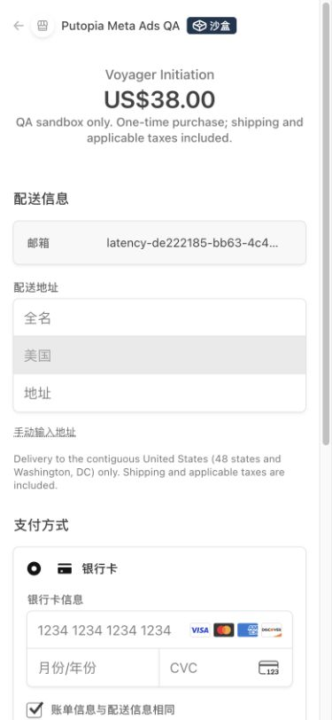
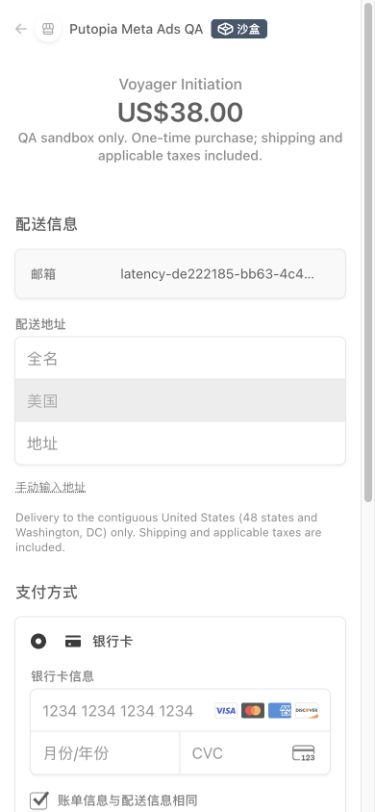

# Initiation 单次请求结账验收 · PR #270

## 结果

使用同一隔离 QA 项目、同一虚构账号、同一个真实 Stripe 测试 Session，在 390×844 视口实测点击 `$38` 按钮到付款表单完整显示。终点同时满足：已进入 `checkout.stripe.com`、银行卡输入框显示且可用、Stripe 的 `.LOADING-container` 遮罩消失、文档 load 完成。没有把输入框提前出现在 DOM 中的时刻当作完整打开。

| 场景 | 优化前 | 优化后 |
| --- | --- | --- |
| 同一 Session 复用，各 5 次 | 3174、2972、2619、2685、2731ms | 1679、1960、1807、2634、1660ms |
| 复用中位数 | **2731ms** | **1807ms（减少 33.8%）** |
| 已登录新建 Session，各 1 次 | 3501ms | 2536ms |

新邮箱从填写邮箱后的 `CONTINUE TO PAYMENT` 到表单完整显示为 3423ms（1 次，排除人工输入时间）。最终代码版本还验证了“输入已有邮箱 → 密码登录 → 一次结账请求 → 同一正确 $38 Session”，从提交登录到收银台完整显示为 2903ms；该场景包含登录请求，不与已登录样本混算。

这是暖缓存、小样本的桌面浏览器竖屏测量，包含自动化观测开销，未模拟实体手机 CPU、4G、冷缓存或其他地区。QA 未配置真实邮件 / PostHog 发送凭据，没有测量它们在后台投递的时间。初始两次跨站自动等待丢失状态但页面后来成功打开，未获取完整计时；正式两组统一改用只读 DOM 状态观测。预热样本独立保存在原始 JSON，未混入配对中位数。

原始计时、安全检查、API 分段和清理回执见 [results.json](results.json)。基准部署 `dpl_7i9ANPkDyBj3afBYpDunJei3SnSi`；优化计时部署 `dpl_7nYgMPk59zLWP29ueahnnx6YFZWY`。随后纳入主干 #269 的 Delivery 标题清理；最终代码 `db19f5c4` 在 `dpl_8poNresjNvVzV2DBeCRLZ1RLpz9V` 重新验证登录到 Stripe，并确认上传源码与本地 `src/` 完全相同。

## 三项优化与付款保护

- 登录购买从“Server Action 预检查 → checkout API”两次串行请求改为一次 API 请求。原有资格、会员 / 授权、批次暂停、容量和异常记录检查移入结账逻辑，与价格选择共用两项升级资格结果；失败仍阻断结账。登录后发现已购 / 已授权 / 可升级账号时先返回刷新提示，展示该账号自己的选项。`afterSignIn` 只能阻止创建，不能授予付款权限。
- 新订单的 Meta 归因和统计上下文通过一次原子 UPDATE 保存。每个字段仅在自身为空时写入；条件同时限定订单、用户、pending 状态和未绑定 Session。重试不覆盖首次记录；并发请求已绑定同一订单时允许继续使用 Stripe 幂等键，已付款 / 取消 / 审核订单和错误用户被拒绝。保存失败发生在 Stripe 创建之前。
- 新邮箱使用只允许 `service_role` 调用的 RPC，数据库按邮箱过滤，只返回最多两条 ID / 激活状态，以识别歧义并失败关闭。没有分页下载 Auth 用户；缺失 profile 的 Auth 账号仍能被发现。读取 Auth 所需的 definer 放在未暴露的 `putopia_private` schema，公开 wrapper 为 invoker，匿名和普通登录用户均无执行权限。旧的补发访问链接流程不在本次范围内。
- Origin 和 Auth 服务验证、服务端金额 / 币种 / 商品 / 价格类型 / 含税 / live-test 模式校验、原子席位预留、历史升级资格、版本化报价、订单归属、Stripe 会话绑定、切换前确认旧链接失效且无付款、固定过期时间与幂等键均保留。未缓存价格、库存、身份或付款事实。
- 邮件 / 统计继续使用原有 `after()` 和持久 outbox，在返回链接后投递；需要先激活、升级确认或已购提示的邮件分支与每 IP 限制保持原有规则。

## 验证与发布

- `design:check`、`tsc --noEmit`、`npm run lint`、`npm test`、`npm run build` 全部通过。884 个 Vitest 用例，lint 0 errors、26 个现有 warnings。
- PostgreSQL/WASM 隔离测试 v103、v108、v109 全部通过：三种价格、旧 $12 升级、历史回执、席位 / 发货去重、退款依赖、满批次升级、RPC ACL、缺失 profile / 大小写 / 歧义账号、首次归因、部分旧记录恢复、并发绑定和已付款 / 审核保护。
- 真实 QA API 验证：无登录 401、错误来源 403、无效方案 400；伪造用户和金额仍返回当前认证用户的 $38 Session；`afterSignIn` 无法跳过暂停检查。匿名 / 普通登录用户调用两个 RPC 均为 42501。错误归因用户被拒绝。
- 实际 `$38 → $488 → $38` 切换金额正确；旧 Session 先 expired，同方案复用相同 Session。
- 新增 `schema_v109.sql` 已先应用到独立 QA，再于 **2026-10-27 07:42 UTC** 应用到正式数据库。正式环境执行后复查 ACL：匿名和普通登录用户无 RPC 执行权限、无私有 schema usage；service_role 执行权限存在。安全扫描未发现与新增函数有关的问题。迁移为增量新增，不修改已有支付记录。
- 全部测试只使用独立 Supabase `gqcgdmmmmfbatdneacny` 和 Stripe sandbox `acct_1UTxRiAPEEV0NYJ8`。未填写银行卡、未接受付款条款、未提交付款；六个 Session 均为 unpaid、无 PaymentIntent，已 expired，预留均 canceled。QA 批次恢复关闭、项目恢复暂停（503 / DEPLOYMENT_PAUSED），测试 webhook 始终 disabled；未配置 QA crons，未改动生产测试订单或外部发送配置。

